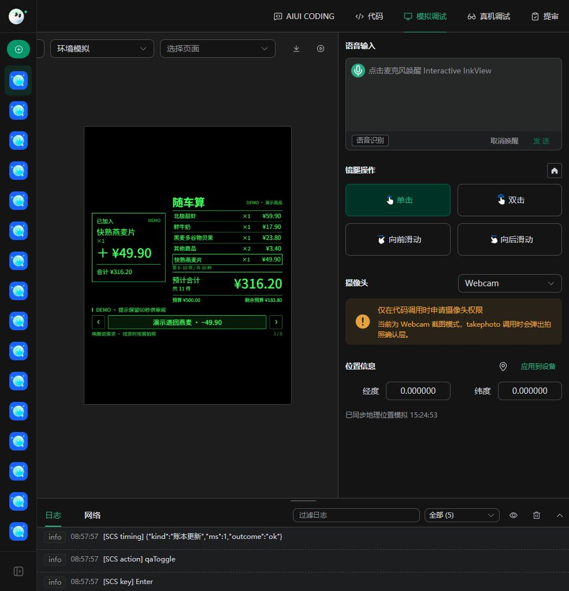
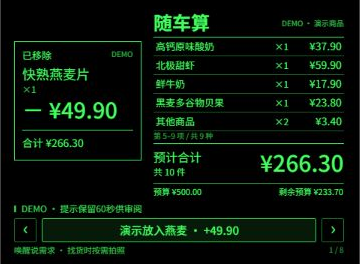

# 随车算

### 面向智能眼镜的静默购物计价助手

随车算希望让购物者在挑选商品时，抬眼就能看到购物清单、商品件数和预计合计。推车、拿取商品时减少掏手机和手动记账，日常使用以无声交互为主，必要时再用语音补充信息。

项目采用 Rokid 沉浸式 AIUI，在独立页面内持续维护购物清单与交互状态。已完成可运行原型及部分模拟调试，正在准备真实眼镜环境下的验证。本页展示项目功能与交互界面。

## 当前完成度 · v0.9.0

已完成可运行原型，最新界面已在 AIUI Studio 验证；独立二维跟随验证工具已进入实拍准备阶段。

- **已跑通界面与账本**：加入和退回商品后，左侧显示商品名与本次加减金额，右侧清单、件数、合计同步更新；正式版本提示3秒自动收起。
- **已完成核价链路联调**：已接入商品识别、独立 OCR 和价格规则核验，完成模拟环境联调。
- **已接入、待实测**：连续选帧、取放证据判断、仅缺价格时暂存待核价、语音与静默切换。
- **整趟购物观察**：取消一分钟截止，主动开启后持续至结束购物；语音或核对后继续，主动暂停、结束购物或离开页面时停止；临时断网和识别异常恢复后自动继续。长时佩戴与续航待实测。
- **二维跟随验证**：已完成独立像素区域跟踪原型，在官方 Ink 运行时验证合成帧移动、遮挡隐藏和手动重锁；真实购物车身份与佩戴对齐待验证，主应用仍为固定 HUD。

## 使用场景

在超市、会员店和便利店中，购物者常常边挑选边估算总价。多人一起选购、临时退回商品、同款购买多件时，记忆中的金额容易与购物车实际内容不一致。

随车算围绕“购物车里有什么、拿了几件、合计多少钱”提供信息。界面聚焦当前清单与金额，让使用者可以继续选购，需要核对时再进行简短确认。

## 目标购物体验

1. **开始购物**：用户主动开启静默购物，眼镜显示当前清单。
2. **自动记录**：取放、商品、数量和价格明确时自动更新清单，抬眼查看件数与预计合计。
3. **处理疑问**：商品、数量或价格不明确时显示核对卡片，由用户确认或修改。
4. **随时修正**：支持退回商品、调整数量、修改单价和撤销操作。
5. **按需说话**：主动唤醒后说出购物指令，处理完成后继续此前的静默观察。明确暂停时保持暂停。

静默自动取放是研发目标，当前尚未完成真实眼镜连续购物验证。先用镜腿触发拍照与候选确认打通核价流程，待连续采集、事件判断与纠错体验经过实测后，再开放相应自动模式。

结束购物后保存本次摘要，可继续修改或开始下一次购物，并保留最近 10 次记录。

预算是可选辅助功能，默认不设置。用户需要时可以主动开启、调整或关闭，不影响清单和合计的使用。

价格未明确的商品显示“待核价”，不会按零元计入完整总价。页面金额是购物过程中的预计值，最终以门店结算为准。

## 界面展示

以下是 **v0.9.0 在 AIUI Studio 实际运行的截图，仅保留应用模拟画面**。使用标有 DEMO 的策划案商品数据，通过本地账本执行加入与退回；本次界面演示没有调用摄像头识别，不能作为自动取放识别或真实佩戴效果的证明。点击图片可查看原尺寸。

| 加入商品 | 退回商品 |
| --- | --- |
|  |  |
| **＋¥49.90**，清单新增燕麦片并高亮；合计 **¥316.20**，共 **11件**。 | **－¥49.90**，清单移除燕麦片；合计 **¥266.30**，共 **10件**。 |

正式版本提示3秒自动收起，无需再点确认，不额外播报，也不暂停正在进行的观察。截图演示包将提示延长至60秒便于审阅；预算为演示中主动设置的可选项，默认不开启。提示出现于账本实际更新后，单纯查价和重复事件不会触发加购提示。仅价格不明时显示“放入待核价／金额待核对”，不把未知价格写成0元。

**当前是固定 HUD：加减提示与清单不会随着实体购物车的位置移动。**

## 商品与价签对应

先辨认正在拿取的包装，再核对对应价签，不能将附近数字直接当作商品价格。

- **包装身份**：读取品牌、品名、口味或型号，以及完整销售包装规格。
- **价签对应**：核对价签标题与规格，区分相邻商品、同名不同规格和单个／整包。
- **价格栏目**：分别读取普通售价、会员价、促销价及单位价。优惠条件不明时不自动采用优惠价格；每公斤或每小份单价不作为整包总价。
- **独立读字核验**：通过单独的 OCR 服务核对同一画面的包装文字、价签区域和金额。模型判断与 OCR 不一致，或独立读字不可用时，保留待核价。
- **称重后贴签**：读取该包装标签上的总金额，按包计数；净重与每公斤单价用于核对，不再次乘重量。标签须对应当前包装，不能借用相邻商品的标签。
- **不确定时补充**：多个价签都可能匹配、文字遮挡或规格不一致时保留待核价，请用户拍清包装与对应价签，或直接补充单价。

商品识别、独立 OCR 与规则核验已完成模拟环境联调。下一阶段将结合真实眼镜，验证不同商品、光照与拍摄角度下的使用体验。

## 技术路线

采用 **AIUI＋视觉模型＋独立 OCR＋规则核验＋本地账本**。眼镜负责取图与交互，视觉模型提出商品和动作候选，独立 OCR 读取同一画面的文字与区域；通过商品、规格、价签和金额核对后，再由本地账本计算件数与合计。

单次核价使用宿主拍照接口，连续观察原型采用抽帧分析。先打通拍照核价完整链路，再验证真实眼镜上的连续采集、取放判断与纠错体验。连续观察尚未达标时，保留镜腿触发拍照与候选确认的无声操作方式。

OCR 当前在本机服务运行，真机需要设备可访问且受鉴权保护的 HTTPS 服务。模型或 OCR 不可用、规格冲突或价格缺失时保留待核价；模型结果不直接写入账本。空间跟随和新款戒指作为后续扩展，不作为首版使用前提。

## 开发进展

| 内容 | 当前状态与证据 |
| --- | --- |
| 购物清单与计价 | 已实现添加、退回、数量和单价修改、优惠计算、撤销与本地恢复 |
| 加减弹窗与清单同步 | v0.9.0 Studio演示通过：＋49.90元／316.20元，－49.90元／266.30元；使用演示数据 |
| 拍照核价 | 图像模型＋独立OCR＋规则核验已完成模拟环境联调，下一阶段进行真机验证 |
| 商品身份核验 | 已加入品牌、品名与完整规格约束，防止同名不同品牌或包装混价 |
| 待核价处理 | 已实现完整取放仅缺价格时暂存；取放或件数不明仍需核对；真实购物体验待测 |
| 连续摄像与取放判断 | 已接入本地亮度／清晰度／画面变化选帧，按延迟与队列调整间隔；主动开启后持续至结束购物，语音或核对完成后继续观察；真实取放准确率与漏记率待测 |
| 语音、手势与点头 | 已接入相关流程和姿态校准；真机语音、手势及佩戴操作待测 |
| 静默与语音切换 | 逻辑实现与自动化检查通过；真实唤醒、打断与恢复体验待测 |
| 二维购物车跟随探索 | 独立区域跟踪工具已运行合成帧验证，支持目标不确定时隐藏与手动重锁；进入真实视频验证准备阶段，主应用仍为固定 HUD |
| 官方接口与前端迭代 | 已建立官方文档参考索引，完成新版前端集成与 Studio 加减商品演示；二维验证页使用官方 Canvas 与采集接口 |
| 真机验证准备 | 准备山姆实拍素材与二维视觉验证，后续开展真实佩戴测试 |
| 设备端OCR服务 | 当前只在Studio连接本机OCR；眼镜可访问的服务与完整链路待部署验证 |
| 新款 Rokid Ring | 尚未适配，取决于官方接口与实机条件 |

2026年10月31日复核：**主应用159项自动测试通过，29个源码文件检查通过；独立二维跟随工具11项测试通过**；已完成AIX打包与完整性检查。这些结果验证程序逻辑和包结构，不代表识别准确率、实际佩戴效果或续航。

下一阶段重点：用山姆连续实拍视频验证原车跟踪、两车交叉、遮挡、转头回看与商品取放；继续完善核价体验并准备设备可访问的OCR服务。后续结合真机验证佩戴显示对齐、连续取放、交互与耗电。

## HUD 跟随购物车

计划探索让清单与金额显示在购物车附近：购物车移动时，HUD 尽量保持与车的位置关系，转头查看货架后再回看购物车，可以自然地找到信息。首要原则是**不能跟错车辆**：目标不确定时隐藏贴车提示，保留稳定的视野内清单；不能确认原车时由用户重新锁定，不自动选择附近相似车辆。

已按官方接口开发独立二维验证工具：手动选择画面区域，读取像素计算跟随位置；合成帧移动、遮挡隐藏、目标返回后保持等待重锁已在官方 Ink 运行时验证。匹配度仅表示图像纹理相关性，不代表车辆身份或识别准确率。

真实购物车身份验证、复杂遮挡与佩戴显示对齐进入下一阶段。当前上方截图仍是固定 HUD；二维画面跟踪不等于空间锚定，头部3DoF姿态也不能单独完成购物车空间定位。

## 使用与隐私

静默购物由用户主动开启。静默期间不打开应用麦克风，也不播放语音；用户主动唤醒后才进入语音操作。暂停或离开页面时停止应用采集。

图像分析使用宿主配置的模型服务；配置独立 OCR 后，核价照片也会发送至该服务。应用及随附 OCR 服务不持久保存采集照片，识别期间使用短时内存缓存。购物清单保存在本地。断网时暂停在线识别，仍可手动修改清单；恢复网络后自动继续此前主动开启的观察；识别服务异常按退避策略自动重试，最长间隔30秒。主动暂停、结束购物或离开页面会取消恢复，中断期间不猜测取放或记账。真实使用时的权限与服务行为将在设备测试中核对。

---

更新日期：2026 年 10 月 31 日
