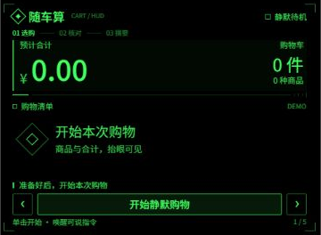
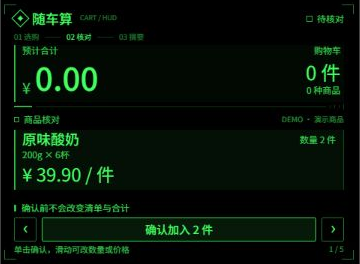
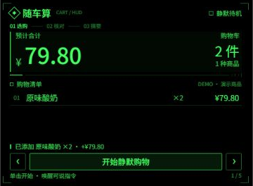
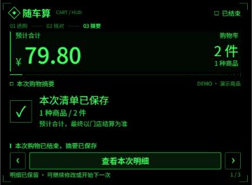

# 随车算

### 面向智能眼镜的静默购物计价助手

随车算希望让购物者在挑选商品时，抬眼就能看到购物清单、商品件数和预计合计。推车、拿取商品时减少掏手机和手动记账，日常使用以无声交互为主，必要时再用语音补充信息。

项目采用 Rokid 沉浸式 AIUI，在独立页面内持续维护购物清单与交互状态。已完成可运行原型及部分模拟调试，正在准备真实眼镜环境下的验证。本页展示项目功能与交互界面。

## 使用场景

在超市、会员店和便利店中，购物者常常边挑选边估算总价。多人一起选购、临时退回商品、同款购买多件时，记忆中的金额容易与购物车实际内容不一致。

随车算围绕“购物车里有什么、拿了几件、合计多少钱”提供信息。界面聚焦当前清单与金额，让使用者可以继续选购，需要核对时再进行简短确认。

## 目标购物体验

1. **开始购物**：用户主动开启静默购物，眼镜显示当前清单。
2. **自动记录**：取放、商品、数量和价格明确时自动更新清单，抬眼查看件数与预计合计。
3. **处理疑问**：商品、数量或价格不明确时显示核对卡片，由用户确认或修改。
4. **随时修正**：支持退回商品、调整数量、修改单价和撤销操作。
5. **按需说话**：主动唤醒后说出购物指令，处理完成后继续此前的静默观察。明确暂停时保持暂停。

静默自动取放是研发目标，当前尚未完成真实眼镜连续购物验证。先用镜腿触发拍照与候选确认打通核价流程，待连续采集、事件判断与纠错体验经过实测后，再开放相应自动模式。

结束购物后保存本次摘要，可继续修改或开始下一次购物，并保留最近 10 次记录。

预算是可选辅助功能，默认不设置。用户需要时可以主动开启、调整或关闭，不影响清单和合计的使用。

价格未明确的商品显示“待核价”，不会按零元计入完整总价。页面金额是购物过程中的预计值，最终以门店结算为准。

## 界面展示

以下均为 AIUI Studio「模拟调试」的实际截图，仅裁出眼镜 HUD。演示商品用于验证界面与计价流程，不代表门店识别或佩戴实拍。

| 开始购物 | 商品核对 |
| --- | --- |
|  |  |
| 默认不设置预算，显示清单与件数。 | 演示核对卡：2 件酸奶，确认前合计仍为 0。 |

| 入账后的清单 | 结束购物摘要 |
| --- | --- |
|  |  |
| 确认后显示 2 件，合计 79.80 元。 | 结束购物后保存摘要，可查看明细或开始下一次。 |

目标体验以静默自动记录为主：取放过程、商品、数量与价格都明确时直接入账；不确定时显示核对卡。数量不明确时可通过镜腿修改，语音与手势作为可选补充；真实佩戴效果仍需验证。

## 商品与价签对应

先辨认正在拿取的包装，再核对对应价签，不能将附近数字直接当作商品价格。

- **包装身份**：读取品牌、品名、口味或型号，以及完整销售包装规格。
- **价签对应**：核对价签标题与规格，区分相邻商品、同名不同规格和单个／整包。
- **价格栏目**：分别读取普通售价、会员价、促销价及单位价。优惠条件不明时不自动采用优惠价格；每公斤或每小份单价不作为整包总价。
- **独立读字核验**：通过单独的 OCR 服务核对同一画面的包装文字、价签区域和金额。模型判断与 OCR 不一致，或独立读字不可用时，保留待核价。
- **称重后贴签**：读取该包装标签上的总金额，按包计数；净重与每公斤单价用于核对，不再次乘重量。标签须对应当前包装，不能借用相邻商品的标签。
- **不确定时补充**：多个价签都可能匹配、文字遮挡或规格不一致时保留待核价，请用户拍清包装与对应价签，或直接补充单价。

已接入上述校验流程，并用现有商品参考图在本机运行独立 OCR。参考图测试不等同于真实货架识别；包装与价签同框、连续拿放以及眼镜端完整流程仍需验证。自动核价需要配置可用的独立 OCR 服务。

## 技术路线

采用 **AIUI＋视觉模型＋独立 OCR＋规则核验＋本地账本**。眼镜负责取图与交互，视觉模型提出商品和动作候选，独立 OCR 读取同一画面的文字与区域；通过商品、规格、价签和金额核对后，再由本地账本计算件数与合计。

单次核价使用宿主拍照接口，连续观察原型采用抽帧分析。先打通拍照核价完整链路，再验证真实眼镜上的连续采集、取放判断与纠错体验。连续观察尚未达标时，保留镜腿触发拍照与候选确认的无声操作方式。

OCR 当前在本机服务运行，真机需要设备可访问且受鉴权保护的 HTTPS 服务。模型或 OCR 不可用、规格冲突或价格缺失时保留待核价；模型结果不直接写入账本。空间跟随和新款戒指作为后续扩展，不作为首版使用前提。

## 开发进展

| 内容 | 当前状态 |
| --- | --- |
| 购物清单与计价 | 已实现添加、退回、数量和单价修改、优惠计算、撤销与本地恢复 |
| HUD 与镜腿交互 | 已在 Studio 验证商品核对、数量修改、入账与结束摘要 |
| 点头确认 | 已接入姿态校准及商品核对确认，真实佩戴待测 |
| 语音与手势数量 | 已接入候选数量修改，手势图像识别待实机验证 |
| 静默与语音切换 | 已完成逻辑实现及自动化测试，真机唤醒体验待验证 |
| 摄像头辅助购物 | 已完成原型接入，连续购物场景的识别效果尚待实机测试 |
| 独立 OCR 核价 | 已接入拍价签及连续观察流程，本机参考图读字已验证；货架正例和真机链路待测 |
| 新款 Rokid Ring | 计划探索无声交互，适配取决于官方接口与实机条件 |
| HUD 跟随购物车 | 计划验证，尚未实现实物跟随 |

当前尚未完成真实眼镜和戒指测试，不将模拟调试结果等同于商超环境中的识别准确率、响应速度或续航表现。

完整 OCR 核价链路尚未在 Studio 或眼镜上验证成功；自动漏记核对、多 SKU 并行追踪、复杂优惠与通用上下文购物指令尚未完成。

## HUD 跟随购物车

计划探索让清单与金额显示在购物车附近：购物车移动时，HUD 尽量保持与车的位置关系，转头查看货架后再回看购物车，可以自然地找到信息。跟踪暂时丢失时，计划回到稳定的视野内显示。

这项体验属于待验证方向，当前截图展示的是固定在视野内的 HUD。移动购物车的跟踪与空间显示需要额外能力，不能仅凭头部 3DoF 姿态保证实现；是否能在目标设备上稳定工作，需要结合官方能力与真实佩戴测试确认。

## 使用与隐私

静默购物由用户主动开启。静默期间不打开应用麦克风，也不播放语音；用户主动唤醒后才进入语音操作。暂停或离开页面时停止应用采集。

图像分析使用宿主配置的模型服务；配置独立 OCR 后，核价照片也会发送至该服务。应用及随附 OCR 服务不持久保存采集照片，识别期间使用短时内存缓存。购物清单保存在本地。断网时暂停在线识别，仍可手动修改清单；恢复网络后由用户主动继续观察。真实使用时的权限与服务行为将在设备测试中核对。

---

更新日期：2026 年 10 月 29 日
