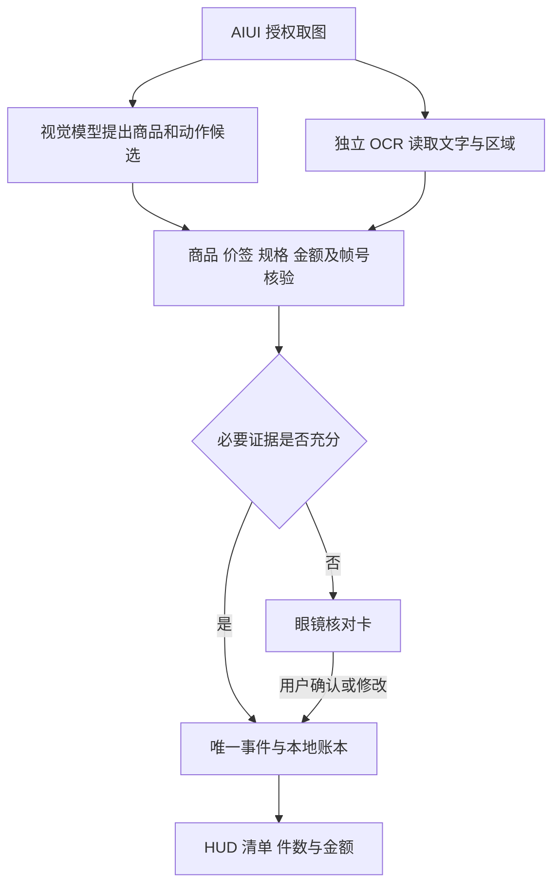

# 随车算技术路线

更新日期：2026 年 10 月 29 日。原型基线：v0.7.0。

随车算面向 Rokid AI Glasses，在购物过程中维护商品清单、件数和预计合计。研发目标是无声为主的自动取放记账；先完成拍照核价闭环，再以真机验证连续观察。预算默认关闭，语音为可选输入，首版显示固定在视野内。

完整方案：[作品策划案在线版](proposal.md)

## 架构与分工

| 层级 | 实现方式 | 边界 |
| --- | --- | --- |
| 眼镜应用 | AIUI 沉浸式 Page，WXML、WXSS 与 JavaScript 模块 | 页面维护购物状态，不依赖空间锚定 |
| 图像理解 | 宿主 LanguageModel，结构化商品、标签和动作候选 | 模型不直接写账，不能用自报分数代表真实正确概率 |
| 独立读字 | RapidOCR、PP-OCRv6 small、ONNX Runtime | 目前本机运行；真机需可访问且有鉴权的 HTTPS 服务 |
| 规则核验 | 商品身份、价签对应、金额栏目、帧号与动作连续性检查 | 证据缺失或冲突时转核对，不猜测价格 |
| 本地账本 | 整数分计算、事件去重、数量与价格修改、撤销和恢复 | 在线识别暂停时仍能修改清单 |

## 两种采集路径

**单次核价**采用 `wx.media.createCameraContext().takePhoto`。当前已在 Studio 用本地测试图片验证取图并进入宿主模型；完整 OCR 核价链路尚未在 Studio 验证成功。官方文档要求该拍照接口从交互调用，不能据此承诺后台循环拍照。

**连续观察**原型采用 `getUserMedia` 和 `ImageCapture`，约每 1.4 秒抽取一帧，每批三帧并带一帧衔接画面进行分析。这是抽帧原型，尚未完成真实眼镜连续购物验证。实际取图间隔、画面覆盖、请求延迟、权限和功耗均需记录。

若目标宿主不支持所需连续采集，先使用镜腿触发拍照和候选确认的静默模式，并核实官方支持路径。原生 SDK 是另行评估的备选，切换前须确认 AIUI 参赛和分发要求。

## 包装与价签核验

视觉模型定位正在操作的包装和标签候选，独立 OCR 读取同一图片的文字及位置，再核对品牌、品名、口味或型号、完整销售包装与金额栏目。OCR 也会错字，双路一致仍可能共同出错。

- 普通包装采用对应价签的整包价格；相邻标签、不同规格和内含小件不能混用。
- 已称重贴签商品采用当前包装的总金额，净重与每公斤单价用于核对，不再次乘重量；不同重量包装逐包核价。
- 会员价、优惠条件或单位价不明确时保留待核价。原型支持第二件半价，复杂满减、券后价和组合优惠仍需人工核对。
- OCR 不可达、文字冲突或证据不足时重拍或手动补充价格，不能回退到模型猜价。
- OCR 返回值绑定请求号与帧号，模型自行声称“已通过 OCR”不生效。完全相同图片的短时读字缓存不等于跨商品价格库。

## 取放状态与交互

货架到手持再到车内稳定，才构成加入候选；车内拿起查看后放回保持原数量；明确退回货架或由用户确认退出选购后，才扣减对应账目。遮挡、去向不明和无法唯一匹配时进入核对，不把商品离开画面直接当作退回。

镜腿选择、确认与返回作为基础输入。点头与手势数量已有原型，佩戴效果待验证；语音主动唤醒后使用，当前以有限购物指令为主。新款 Rokid Ring 与车旁空间 HUD 均为后续扩展。

## 当前验证状态

| 已有证据 | 可以说明什么 | 不能替代什么 |
| --- | --- | --- |
| 104 项自动化测试、21 个源文件检查通过 | 账本、校验及异常处理的逻辑覆盖 | 真实识别准确率 |
| Studio 购物流程与 v0.7.0 首屏验证 | 界面、交互与启动可运行 | 眼镜佩戴体验 |
| 5 张参考图的本机真实 OCR | OCR 能实际读字；单次推理约 0.27 至 1.02 秒 | 端到端速度、真实货架核价 |
| 单次拍照进入宿主模型 | 该测试路径可触发模型处理 | 商品识别正确性及 OCR 全链路 |

一次模型结果曾将图片上的 1.8 千克识别为 1.35 千克，随后补充品名与规格 OCR 校验，仍需真实素材复测。现有参考图没有包装与货架价签同框的真实正例。

自动漏记核对、多 SKU 并行追踪、复杂优惠与通用上下文购物指令尚未完成。画面外的同行人加货可能完全无法被发现，不能把“没有看到变化”当作账目完整。

## 验证顺序与运行条件

1. 收集真实包装、对应价签及已称重贴签样本，标注商品身份、金额和销售单位，保留独立验证集。
2. 在目标眼镜上验证相机权限、取图质量、宿主模型和外部 OCR 的完整链路。
3. 验证加入、退回、查看、遮挡及多人取放；分别统计可见动作与全部实际动作的覆盖。
4. 对比手机手记、镜腿确认和自动模式的确认次数、纠错成本、延迟、耗电与每次购物费用，再决定自动模式的开放范围。

OCR 当前仅在本机运行，默认普通包未配置服务地址。真机不能使用开发电脑的 localhost，需部署设备可达的 HTTPS 服务并配置鉴权。图像分析会向宿主模型及已配置的 OCR 服务发送必要画面；应用与随附 OCR 服务不持久保存照片，第三方模型服务的数据保留策略需另行核实。

暂停、退出页面或断网时停止在线识别并保留清单；网络恢复后由用户主动继续。价格不完整时展示已核价小计与待核价项，最终结算以门店收银为准。

## 官方资料

- [AIUI 媒体接口](https://github.com/yodaos-project/AIUI/blob/main/skills/aiui-dev/references/apis/media.md)
- [AIUI 相机与 wx 接口](https://github.com/yodaos-project/AIUI/blob/main/skills/aiui-dev/references/apis/wx.md)
- [AIUI 图像模型与语音接口](https://github.com/yodaos-project/AIUI/blob/main/skills/aiui-dev/references/apis/ai.md)
- [AIUI 网络接口](https://github.com/yodaos-project/AIUI/blob/main/skills/aiui-dev/references/apis/web.md)
- [RapidOCR 官方项目](https://github.com/RapidAI/RapidOCR)
- [Spatial Joy 2026 赛事规则](https://spatialjoy.rokid.com/2026/rules)

